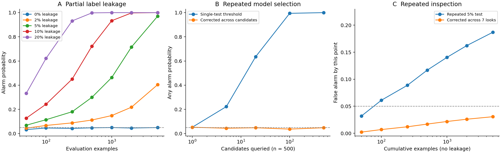

# Capped Evaluation under Leakage and Repeated Feedback

A reproducible **synthetic study** of statistical reliability in AI evaluation, inspired by [CapBencher](https://arxiv.org/abs/2505.18102) (Ishida et al., ICML 2026).

The experiments investigate partial label leakage, repeated hypothesis testing, and feedback-driven model selection using a simplified task with a known 50% expected matching cap. Exact binomial tests and Monte Carlo simulations allow the effects of sample size, test reuse, and statistical corrections to be examined under explicit assumptions.

This study does not involve real LLM inference, model training, or multi-agent workflows. Implementation and execution were assisted by AI. Source code, parameters, numerical results, and limitations are available for inspection and reproduction.



## Quick start

Python 3.11+; CPU only. No model weights, API keys, GPU, or proprietary data are required.

```bash
git clone https://github.com/shude-chen/Capped_Evaluation.git
cd Capped_Evaluation/capped-evaluation-pilot
python -m venv .venv
source .venv/bin/activate
python -m pip install -r requirements.txt
python run_experiment.py --out results --repeats 20000 --seed 20261002 > console_summary.json
```

On Windows, activate the environment using `.venv\Scripts\activate` instead. To avoid overwriting the provided results, choose a different `--out` directory.

## Main observations

Each simulated condition uses 20,000 independent trials with seed 20261002.

| Setting | Measured result |
|---|---:|
| No leakage, 500 examples, single test | 4.74% alarm rate |
| 10% probabilistic label leakage, 500 examples | 72.26% detection |
| 10% probabilistic label leakage, 2,000 examples | 99.75% detection |
| Fixed clean predictor, seven nominal 5% tests | 18.71% cumulative false alarms |
| Same seven looks, Bonferroni correction | 3.06% cumulative false alarms |
| Select among 100 fixed random candidates | 55.60% reused-set score; 49.99% fresh score |

Selecting the best-performing candidate on a reused test set can inflate the apparent score even without direct access to hidden labels. This is **selection overfitting**, not necessarily training-data leakage or intentional cheating. Corrections for a prespecified set of candidates do not automatically provide guarantees for arbitrarily feedback-adaptive model development.

## Task construction

For an arithmetic sum such as 12+8, either 19 or 21 is rule-compliant under a minus/plus-one instruction. The evaluator uses an independent private fair coin to select one as its stored target. A predictor with no access to that random choice has a 50% *expected* matching rate. Scores on a finite sample may exceed 50% by chance, so a one-sided exact binomial test is used to evaluate unusually high scores.

The study considers independent probabilistic label exposure; selection from precommitted random candidates; repeated inspection of a fixed predictor; and an idealized exact-score feedback example. Most conditions operate directly on binomial counts where the score distribution is known. These experiments do not model language understanding, actual LLM training, or agent execution.

## Files

- [`run_experiment.py`](run_experiment.py): simulation and plotting code.
- [`report.md`](report.md): full English report, results, and interpretation.
- [`METHODS.md`](METHODS.md): statistical design, assumptions, and limitations.
- [`docs/guide_zh.md`](docs/guide_zh.md): explanatory Chinese guide.
- [`results/`](results/): CSV results, metadata, toy data, and PNG/SVG figures.

The private target bits in `toy_task_examples.json` are disclosed for offline auditing only. In the feedback demonstration, the simulated attack receives evaluator scores, not hidden target bits. No actual secret or third-party private information is included.

## Reproducibility

The code checks the binomial rejection thresholds and the exact-label reconstruction demonstration. Monte Carlo estimates were compared with analytic probabilities; the largest discrepancy was 3.23 Monte Carlo standard errors, within a prespecified five-standard-error tolerance. A complete second run with the same seed reproduced the numerical JSON and CSV files byte for byte. Environment information and the source SHA-256 are recorded in [`results/summary.json`](results/summary.json).

## Scope and limitations

This preliminary study illustrates finite-sample uncertainty, selection bias, and repeated inspection in an idealized evaluation task. The statistical corrections are established baselines, not new detection methods. The experiments do not evaluate real LLMs, cascading errors in multi-agent workflows, or selective verification policies. Extending these ideas to agentic systems would require distinct experiments and validation.

CapBencher itself studies benchmark feedback and leaderboard overfitting with real models; this project does not claim those topics as previously unexplored. See the [report](report.md) for detailed assumptions and the distinction between selected-test alarms and fixed-predictor false alarms.

## Reference

T. Ishida, T. Lodkaew, and I. Yamane. **CapBencher: Give Your LLM Benchmark a Built-in Alarm for Test-Set Overfitting.** ICML 2026. [arXiv:2505.18102v7](https://arxiv.org/html/2505.18102v7).

The code is a simplified implementation exercise; the randomized-answer construction and underlying binomial-testing idea are attributed to CapBencher. No paper text, datasets, or third-party source code are redistributed.
